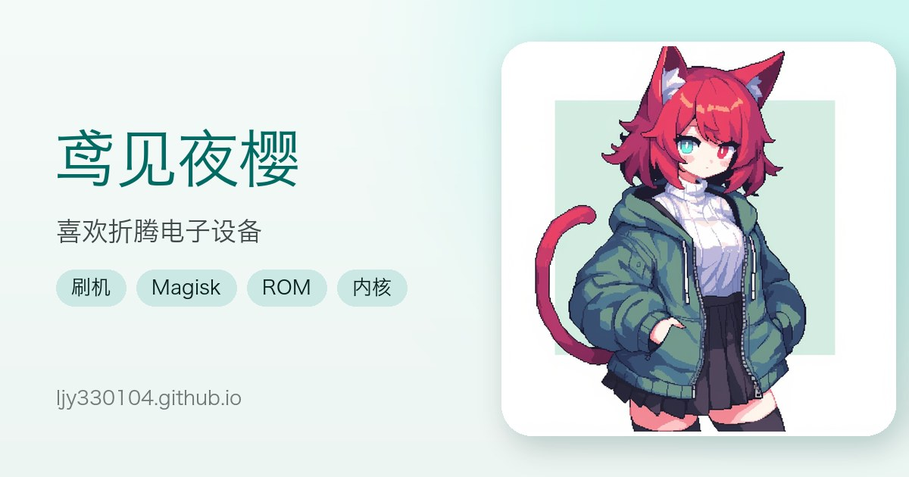

# 鸢见夜樱 | 个人网站



一个记录 Android 折腾、设备收藏与个人项目的静态个人主页。

- **在线访问**：<https://ljy330104.github.io/>
- **我的项目**：<https://ljy330104.github.io/HTMLvocab/>

## 功能

- **单页个人主页**：首页、关于、技能、折腾历程、设备、项目、友链、联系。
- **Material You 主题**：亮色 / 暗色模式，默认跟随系统，也可手动切换并记住选择。
- **新扁平化 + 轻新拟物视觉**：统一的圆角、阴影、配色与悬停反馈。
- **响应式布局**：适配桌面、平板与手机；移动端导航支持横向滚动。
- **滚动入场动画**：使用 `IntersectionObserver`，并提供降级与兜底处理。
- **折叠时间线**：默认展示前 3 条历程，可展开全部或收起。
- **横向设备墙**：设备卡片单行横向滚动，左右边缘渐隐，可一键回到最左；包含设备状态与 Root 标签。
- **项目展示**：外链到 HTMLvocab 词汇复习项目。
- **互动细节**：点击兴趣标签展开详情、版本号彩蛋等。
- **PWA**：支持安装到桌面 / 主屏幕，首次访问后可离线浏览。
- **SEO 与分享**：Canonical、Open Graph、Twitter Card、`robots.txt`、`sitemap.xml` 和自定义 404 页面。

## 技术栈

- 原生 HTML、CSS、JavaScript
- 无框架、无构建步骤、无运行时依赖
- CSS 自定义属性（设计令牌）与 Material You 配色
- `IntersectionObserver`、`Service Worker`、Web App Manifest
- CSS Mask、`@property`、Grid 行高过渡等渐进增强特性
- 字体使用系统字体栈，图片资源存放在 `websrc/`

## 目录结构

```text
.
├── index.html          # 单页站点：结构、样式与交互逻辑
├── 404.html            # 自定义 404 页面
├── manifest.json       # PWA 清单
├── sw.js               # Service Worker（离线缓存）
├── robots.txt          # 搜索引擎抓取配置
├── sitemap.xml         # 站点地图
├── websrc/             # 头像、图标、标签详情配图等静态资源
└── README.md
```

## 本地运行

项目没有构建步骤，直接启动一个静态文件服务器即可：

```bash
git clone https://github.com/LJY330104/ljy330104.github.io.git
cd ljy330104.github.io
python3 -m http.server 8080
```

然后打开 <http://localhost:8080/>。

> Service Worker 只在 `http://localhost` 或 HTTPS 环境下生效；直接双击 `index.html` 以 `file://` 打开时不会注册，也无法完整测试 PWA / 离线能力。

## 部署

仓库推送到 GitHub 的 `main` 分支后，由 GitHub Pages 自动发布：

```bash
git add .
git commit -m "docs: update README"
git push origin main
```

由于仓库名是 `ljy330104.github.io`，站点会发布在 <https://ljy330104.github.io/>。

如果 fork 到自己的账号，请同步修改以下位置中的域名和个人信息：

- `index.html` 中的 `canonical`、`og:url`、`og:image`、Twitter Card 等 SEO 信息
- `sitemap.xml` 与 `robots.txt` 中的站点地址
- `manifest.json` 中的应用名称、图标与主题色

## 维护提示

- **修改缓存资源后**：更新 `sw.js` 中的 `CACHE_VERSION`，避免老访客继续使用旧缓存。页面导航采用 network-first，HTML 通常能及时拿到新版本。
- **内容有较大更新后**：同步更新 `sitemap.xml` 中的 `<lastmod>`。
- **新增外链时**：保留 `target="_blank"` 与 `rel="noopener noreferrer"`。
- **调整主题色时**：优先修改 `:root` 与 `[data-theme="dark"]` 中的设计令牌，不要在各组件里硬编码颜色。
- **发布前建议在本地检查**：桌面与移动端布局、亮暗主题、键盘焦点、时间线折叠、设备横向滚动和 PWA 注册。

## 浏览器支持

面向现代浏览器（最新版 Chrome、Edge、Firefox、Safari）。部分视觉效果使用 CSS Mask、`@property` 和 Grid 动画等较新特性，旧浏览器会自动降级，不影响主要内容阅读。站点同时适配 `prefers-reduced-motion`。

## 版权

本站为个人站点。除特别注明外，文字、头像与图片版权归鸢见夜樱所有；仓库未附带开源许可证，请勿直接搬运个人内容与图片。友链内容归各自站点所有。

有建议或想交流，欢迎通过站点「联系我」中的方式找到我。
